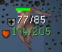
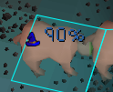
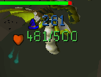

# NPC Stat Tracker

Tracks the combat stats of **any attackable NPC** - Attack, Strength, Defence, Ranged, Magic and
Hitpoints - through stat-draining special attacks and the NPC's natural regeneration. Works solo; in a
RuneLite / Hub Party it also shares specs with party members, through RuneLite's standard Special Attack
Counter message; NPC Stat Tracker users additionally sync tracked boss state with each other.

Fork of [Better Party Defence](https://github.com/Falsary/better-party-defence) - see `ATTRIBUTION.md`.

## Screenshots

| Defence and hitpoints | Magic defence (percent) | Magic defence and hitpoints |
|---|---|---|
|  |  |  |

Each stat can be switched on or off under **Stats Shown** in the plugin settings.

## Stats

Each stat has its own toggle under **Stats Shown** (Magic keeps its existing "Magic Defence" section),
plus "Only drained stats" to hide anything still at its starting level.

- **Defence / Magic**: drained by DWH, Elder maul, BGS, Arclight family, Anchor, Bone dagger,
  Dorgeshuun crossbow, Accursed sceptre, Ralos, Seercull, Eye of ayak.
- **Attack / Strength**: drained when a Bandos godsword spec overkills Defence and spills over.
- **Ranged**: shown at base; no supported spec drains it.
- **Hitpoints**: estimated current/max from the health bar (same maths as RuneLite's opponent info);
  hidden when no health bar is showing; a percentage for scaled Chambers of Xeric monsters.

Base stats come from the OSRS Wiki DPS calculator's monster data (2,817 NPC ids, bundled as
`npc_stats.tsv`). About 60 bosses keep hand-tuned entries with raid scaling and phase handling. Every
other NPC is tracked strictly per NPC: its state never moves to another monster with the same name, it
is cleared when that NPC despawns, and it isn't part of the party state-sync (plain spec events are
still shared). An NPC id missing from the data falls back to the first entry with the same name, which
can pick the wrong version for names with several stat blocks.

### NPC ids shared between versions

Some NPC ids are used by several versions with different stats. The plugin tells them apart by the
NPC's **combat level**:

- **Awakened Desert Treasure II bosses** (Duke Sucellus, The Leviathan, The Whisperer, Vardorvis) use
  Awakened stats and ignore all drains, since Awakened bosses are immune to stat drains. Normal kills
  use the post-quest stats.
- **Doom of Mokhaiotl** gets the right max HP per delve level. Delve 8 and Deep Delve share a level,
  so HP is shown as a percentage there.
- **Deadman-mode variants** (Big Evil Chicken, Giant goblin, Magic Mark, Ranging Ro, I DSCIM YOU)
  get their own stats.

Can't be told apart (same combat level), so the normal version is used:
- **Maggot King**: Defence 200; its Roaring form actually has 100.
- **Black Eye Bethel**: stats change with his weapon; the Dragon scimitar version is used.
- **Blood spawn** (ToB Entry vs Normal) and **Phosani's totems**: HP is shown as a percentage.

Also: **The Whisperer** restores her drained stats when she reaches 0 HP and starts her enrage phase.
The tracker clears her state when her health bar hits 0, so it matches.

## Regeneration

NPCs regain 1 level of every drained stat (Defence, Attack, Strength, Magic) and 1 hitpoint on a fixed
timer. Most NPCs use 100 ticks (60s), but many bosses differ. Rates come from the OSRS wiki table
(User:Orion/Regen):

| NPC | HP | Stats |
|---|---|---|
| Default (unlisted) | 100 | 100 |
| General Graardor, Commander Zilyana, Vasa, Vespula | 10 | 10 |
| Zulrah, awake Vorkath | 5 | 5 |
| Cerberus, Lizardman shaman | 20 | 20 |
| Tekton | 15 | 15 |
| Skeletal Mystic | 25 | 25 |
| Abyssal portal | 45 | 45 |
| Nex | never | 50 |
| Akkha | never | 20 |
| Kephri, Zebak, Ba-Ba, Phantom Muspah, Vardorvis | never | 100 |
| Pestilent Bloat | never | 5 |

Special cases handled:
- **Vorkath**: the sleeping NPC's 100-tick timer has to run out once before the awake 5-tick rate applies.
- **Vasa**: fully regains his stats after leaving a crystal.

Option (Regeneration section): toggle stat regen. The Defence infobox tooltip lists the NPC's regen rates.
There are deliberately no countdowns to the next regen: Jagex's third-party client guidelines prohibit
indicating when a boss mechanic starts or ends.

### Accuracy notes
- The timer is anchored to when the NPC **appeared in your scene**. That is exact for bosses that spawn
  while you are there (instanced bosses, respawns you wait for), but early if you walk up to an NPC that
  had already been alive for a while. If the spawn wasn't seen at all, the timer starts at the first
  tracked spec.
- Not modelled: Zulrah pausing regen during phase transitions, Bloat resetting Defence when it stomps,
  Vardorvis's HP-scaled Defence, and the Tekton anvil heals.
- In a party, regenerated values are shared through the normal sync, but two clients whose timers are
  anchored differently can briefly disagree.
- Vasa's crystal detection uses NPC id 7567 (`RAIDS_VASANISTIRIO_HEALING`) and has not been checked in game.
- Telling shared-id versions apart assumes the client reports each version's own combat level (the
  wiki lists different levels, e.g. Duke 758 vs 1,099 Awakened). Not checked in game; if the client
  reports one level for both, the normal version's stats are used.

## Building

```
./gradlew build
```
The jar is `build/libs/npc-stat-tracker-1.0.0.jar`.
